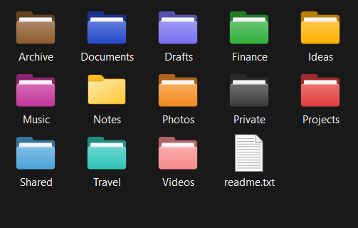
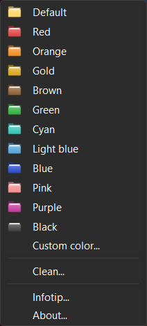
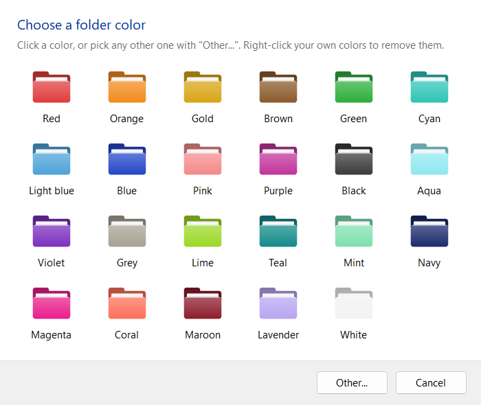

# FolderHighlight

Color and annotate your Windows folders straight from the Explorer context menu.

FolderHighlight is a small, self-contained reimplementation of the classic FolderHighlight shell tool.
It ships as a single executable of about 360 KB, needs no runtime and no administrator rights, and
changes the look of a folder instantly.

<p align="center">
  
</p>

## Features

- Twelve ready-made colors in the context menu, plus a palette of 23 colors and a color picker for anything else
- Your own colors are remembered and can be removed again with a right-click
- Folder tooltips (infotips) shown when hovering a folder
- Changes appear immediately, without restarting Explorer or refreshing the view
- Colors are portable: each colored folder carries its own icon file, so the color survives copying
  the folder to another drive or computer
- Works on several selected folders at once, with a single confirmation
- No installer, no background process, no dependencies

## Screenshots

<table>
  <tr>
    <td align="center" valign="top"></td>
    <td align="center" valign="top"></td>
  </tr>
  <tr>
    <td align="center">Context menu</td>
    <td align="center">Color palette</td>
  </tr>
</table>

## Installation

1. Download `FolderHighlight.exe` from the [latest release](../../releases/latest) and put it in a folder of your choice. It must stay there, because the
   context menu points to it.
2. Run it and answer **Yes** to add the menu to Explorer.
3. Right-click any folder. On Windows 11, choose **Show more options** first (or hold Shift while
   right-clicking).

To remove the menu, run the executable again and answer **No**. Colors already applied to folders are
left untouched; use **Clean...** beforehand to remove them.

## Usage

| Menu entry | Action |
| --- | --- |
| Default ... Black | Apply the color. **Default** restores the standard folder icon |
| Custom color... | Open the palette: pick one of 23 colors, or **Other...** for any color |
| Clean... | Remove the color and tooltip from the selected folders and all their subfolders |
| Infotip... | Set or clear the tooltip of the folder |
| About... | Version information |

The same actions are available from the command line:

```text
FolderHighlight.exe install | uninstall
FolderHighlight.exe set <color|#RRGGBB> <folder>...
FolderHighlight.exe custom <folder>...
FolderHighlight.exe infotip <folder>...
FolderHighlight.exe clean <folder>...
```

Color names are `red`, `orange`, `gold`, `brown`, `green`, `cyan`, `lightblue`, `blue`, `pink`, `purple`,
`black`, `aqua`, `violet`, `grey`, `lime`, `teal`, `mint`, `navy`, `magenta`, `coral`, `maroon`,
`lavender`, `white` and `default`.

## How it works

- **Folder appearance.** For each colored folder, FolderHighlight writes an icon file
  (`FolderHighlight_<rrggbb>.ico`, hidden) and a `desktop.ini` that references it by relative path. The
  icon is set through the shell's own `SHGetSetFolderCustomSettings` API, which is what makes Explorer
  refresh immediately.
- **Icons.** The folder icons are drawn by the program itself (anti-aliased shapes encoded as PNG icon
  images), so any color can be produced without bundled artwork.
- **Context menu.** The menu is registered per user under `HKCU\Software\Classes\Directory`, both for
  folders and for the background of an open folder. No shell extension DLL is loaded into Explorer.
- **Saved colors.** Custom colors are stored in `HKCU\Software\FolderHighlight`.

## Limitations

- 64-bit Windows; developed and tested on Windows 11.
- Classic context menus are limited to 16 entries per cascade, which is why the menu offers twelve colors
  and the rest are reached through **Custom color...**.
- On Windows 11 the menu lives under **Show more options**; the new compact menu requires a packaged
  shell extension, which this project deliberately avoids.
- As with every folder customization made through `desktop.ini`, a customized folder carries the
  read-only attribute.

## Building

You need the Rust toolchain with the MSVC target (`x86_64-pc-windows-msvc`).

```text
cargo build --release
```

The executable is written to `target/release/FolderHighlight.exe`. Every push is also built by GitHub Actions
(the executable is available as a build artifact, and pushing a `v*` tag publishes it as a release). The build embeds the application icon,
the menu icons and a manifest without needing the Windows SDK resource compiler.

| Path | Content |
| --- | --- |
| `src/main.rs` | Commands, desktop.ini handling, menu registration |
| `src/win.rs` | Registry, shell and task-dialog helpers |
| `src/ui.rs` | Text prompt and color palette windows |
| `src/icon.rs` | Folder icon renderer and ICO encoder |
| `src/colors.rs` | Color tables |
| `build.rs` | Resource generation (icons, manifest) |

## License

Released under the [MIT License](LICENSE).

